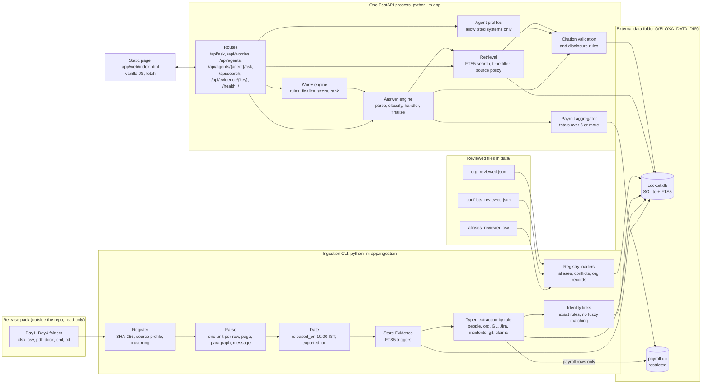
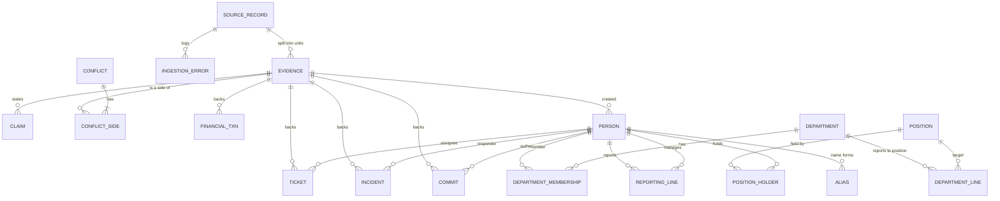
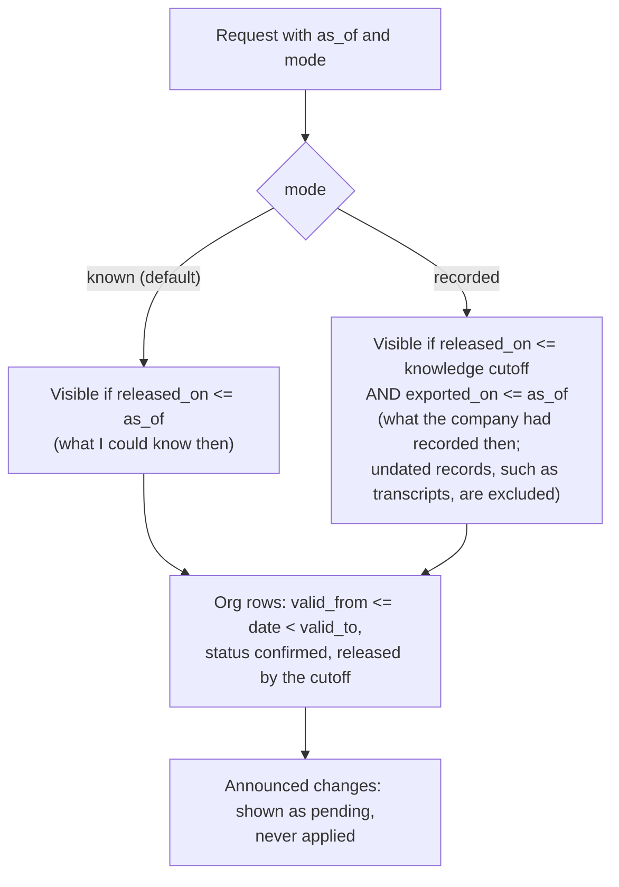
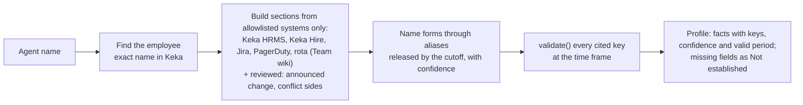
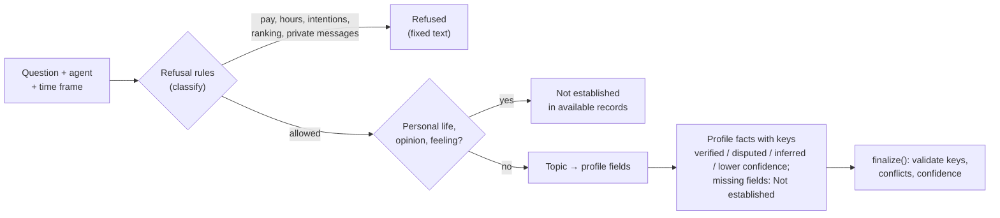
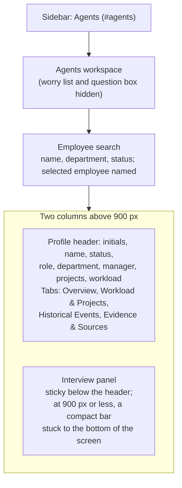
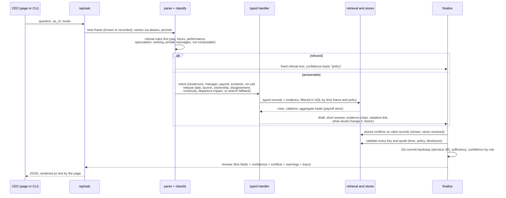

# Veloxa CXO Cockpit: System Design

This is a standalone description of the system as built on 20 November 2026.

- `ARCHITECTURE.md` sections 1-14 are the Day 2 design; section 16 records each build checkpoint in order.
- `DECISIONS.md` holds the reasoning.
- This document describes only what the code does. Section 9 lists what was planned or is optional and is not built.

## 1. System overview

**Purpose.** The CEO of Veloxa (a fictional 19-person company) asks a question and gets a short answer:

- built from the company's records;
- citing the exact records it rests on;
- with a confidence level set by rule;
- saying when the sources disagree, when nothing supports an answer, or when a rule forbids one.

The cockpit opens on a ranked "what to worry about" list. It also gives evidence-only profiles of 14 employees (the "agents"), and the CEO can ask a question about any one of them. The answer is a briefing from that person's records, never the person speaking.

**Scope.**

- One user.
- Local, offline-capable, one Python process.
- Data comes from a release pack of system exports, emails, documents and machine-generated call transcripts, released in four daily drops (16-19 Nov 2026).
- No live connectors, authentication, multiple users or external services.

**High-level shape.** A batch ingestion CLI writes an SQLite evidence store. A FastAPI process reads it, read-only, and serves a JSON API and one static page. Every answer, worry and profile is computed deterministically at request time for a chosen time frame.

| Component | Package | Responsibility |
| --- | --- | --- |
| Ingestion | `app/ingestion` | Register, parse, date and store every unit of every source file. Extract typed facts by rule. Link name forms to people. Load the three reviewed files |
| Data model | `app/models`, `app/database.py` | SQLAlchemy models over SQLite, a schema-version guard, and an FTS5 index over evidence |
| Time rules | `app/temporal.py`, `app/repositories/temporal.py` | IST normalisation, release times, the two time-frame modes, SQL point-in-time filters |
| Identity and org | `app/services` | Exact name resolution through aliases. Effective-dated reporting lines and memberships |
| Retrieval | `app/retrieval` | Full-text search, source policy, citations and their validation, conflicts, disclosure rules |
| Answer engine | `app/answering` | Parse, classify, typed handlers, a finalize step (conflicts, citation checks, sufficiency, confidence), and an optional wording hook |
| Worry list | `app/worries` | Candidate rules, then finalize, scoring and ranking |
| Agents | `app/agents` | The 14-agent roster, evidence-only profiles from allowlisted systems, and the shared interview engine (`interview.py`) |
| Payroll privacy | `app/privacy/payroll.py` | A separate payroll store; only aggregate totals leave it |
| API and UI | `app/api`, `app/main.py`, `app/web/index.html` | JSON routes and one static page (vanilla JavaScript) |
| Operations | `app/readiness.py`, `*.ps1`, `scripts/common.ps1` | Read-only database readiness; setup, load, start and verify scripts |

## 2. Architecture diagram

Boundaries:

- **Ingestion is the only writer.** The web process reads. On start it creates the schema only if missing, and `start.ps1` refuses to start on an empty or missing database.
- **Payroll is a separate file.** `payroll.db` is opened only by `PayrollStore` and `PayrollAggregator`. The cockpit database holds payroll evidence rows with the amount columns removed.
- **No answer bypasses the checks.** Every answer, worry and profile passes through citation validation, which applies the source policy, the time frame and the disclosure rules.

## 3. Data architecture

### 3.1 Sources and ingestion

Each file is matched to a source profile (`app/ingestion/profiles.py`), which gives its system, its trust rung (1 is most authoritative) and its parser:

| Rung | Sources (system) |
| --- | --- |
| 1 | GL export (Zoho Books); payroll register (restricted) |
| 2 | Board updates (Management); vendor invoices |
| 3 | Employee master (Keka HRMS); hiring tracker (Keka Hire); Jira; PagerDuty; git log (GitHub); leave register; pulse survey; resignation letter; launch kit |
| 4 | Emails (.eml); on-call rota (Team wiki, a copied plan) |
| 5 | Call transcripts and CEO voice notes (MeetNotes AI) |
| none | Templates (skipped); README and brief (reference); the printed email copy (a copy, not a second source) |

`python -m app.ingestion ingest PATH --release-day YYYY-MM-DD [--exported-on YYYY-MM-DD]` processes each file in its own transaction:

1. **Register.** Hash the bytes. A known hash is a duplicate, and nothing is written.
2. **Parse** with a deterministic parser per type (CSV, XLSX via openpyxl, PDF via PyMuPDF, DOCX, EML, TXT). Each unit gets a locator: sheet and row, page, paragraph, or message.
3. **Date.**
   - `released_on` is 10:00 IST on the release day: the time the record could first be known.
   - `exported_on` comes from the file itself where it says so (an email Date header, a board update's sent date, a dated invoice). Otherwise from `--exported-on` or a README. Transcripts never get one.
   - UTC sources are converted to naive IST.
4. **Store** one `Evidence` row per unit, with a permanent key (E001, ...). FTS5 triggers index it.
5. **Typed extraction**, by rule only: people, departments, memberships and reporting lines from Keka; GL transactions; Jira tickets and epics; PagerDuty incidents; git commits; release-date claims. Unparseable values are logged against their row, never imputed. A value that contradicts an earlier file creates a `Conflict`; it never overwrites.
6. **Identity links.** An exact rule links a Jira initial, a git email or a PagerDuty name to a person, through an `Alias` row with a confidence. Ambiguous and unresolved names stay unlinked.

Three reviewed files are then loaded, each idempotent and only ever adding rows. Every reference must match exactly one ingested row, or that record is rejected.

- `aliases_reviewed.csv`: name links approved by a person, each with its evidence and its release date.
- `conflicts_reviewed.json`: documented disagreements between records, each side located in one evidence row.
- `org_reviewed.json`:
  - a contractor (a `Person` with no Emp ID, never counted as staff);
  - an announced, not effective, reporting change (a `DepartmentLine` with status `announced`);
  - a CEO-reported event (a `Claim` with status `reported_unverified`, never applied to HR data).

### 3.2 Entities and relationships

- `SourceRecord` holds the file's path, SHA-256, system, trust rung, role (evidence, copy, reference or template), access (restricted or not) and both dates.
- `Evidence` holds the unit's text (`content`), its structured cells (`fields_json`), its locator and its dates.
- Org rows (memberships, reporting lines, position holders, department lines) are effective-dated, with `valid_from`, `valid_to`, `start_exact` and `status`. A change closes one row and adds another; nothing is overwritten.
- `Project` lists projects, and `AppMeta` holds the schema version.
- `payroll.db` holds `PayrollEntry` and a record of released aggregates, used to block differencing.

### 3.3 Evidence and citations

A citation is built only from a stored `Evidence` row and its `SourceRecord`:

- the key;
- the file and locator;
- the system and rung;
- the date as written;
- `exported_on` and `released_on`;
- the source hash.

`validate()` (`app/retrieval/citations.py`) checks every cited key, at the answer's time frame, against these rules:

- the key exists;
- it was released by the time frame;
- it was recorded by the time frame, in recorded-by mode;
- the source is not restricted, not purpose-limited (outside its purpose), and not a copy, reference or failed source;
- any quote appears in the record;
- the text is not withheld by the disclosure rules.

One failure withholds the whole answer.

### 3.4 Temporal data and point-in-time queries

Every request runs in a `TimeContext`, either "known at" or "recorded by". A date with no time means 23:59:59 IST.

These filters run in SQL (`visible`, `released_by`, `valid_at`, `pending`). So a later record, conflict, alias or reviewed record cannot appear in an earlier time frame.

Example: the Day 4 voice note T6d and the alias "Pria" are both released at 19 Nov 10:00. At 09:59 neither is known.

## 4. Agent architecture

The 14 agents (`app/agents/roster.py`):

| Department | Agents |
| --- | --- |
| Engineering | Vikram Menon, Priya Nair, Arjun Das, Sneha Kulkarni, Rahul Verma |
| Finance | Meera Iyer, Karthik Subramanian, Fatima Sheikh |
| People & Ops | Deepa Joshi, Rohan Banerjee, Lakshmi Pillai |
| Marketing | Nikhil Bose, Aisha Khan, Siddharth Mehta |

The CEO, two Sales and two Support staff are people in the model but not agents.

**What an agent is.** An evidence-only profile, computed for a time frame (decisions 24 and 27), with a question box over it (section 4.1). It is not a model of the person:

- no invented persona;
- no memory;
- no LLM.

It has nine fields: role, department, reporting manager, employment, responsibilities, current projects, workload indicators, historical events and pending changes. A field with no eligible record says "Not established" and why.

Transcripts, voice notes, emails, git commits and their times, the leave register, the pulse survey, payroll and letters are never used in profiles.

### 4.1 Agent interviews

`app/agents/interview.py` is one shared, rule-based engine for all 14 agents (decision 35). It has no LLM, no memory and no per-agent service. `GET /api/agents/{agent}/ask?q=` and the interview panel of the Agents workspace (section 4.2) call it. For one question about the selected employee it:

1. adds the employee as the person asked about, then applies the answer engine's classifier, so its refusals apply unchanged: individual pay, working hours and performance, intentions, resignation ranking and private messages;
2. answers personal life, opinions, feelings and motivation with "Not established in available records", citing nothing;
3. maps the question to profile fields by fixed word rules: role, department, manager, employment and history, responsibilities, projects, workload and pending changes. A question that matches none gets "Not established in available records" and the list of topics covered;
4. builds the employee's profile at the same time frame and answers only from its facts, each with its keys. Only a High-confidence fact is labelled verified. Below High, the label gives the reason: disputed (an open conflict), inferred (a name link below High) or lower confidence. A field with no fact says "Not established in available records" and why;
5. passes the draft through the answer engine's `finalize()`: every key is validated again (time frame, source policy, disclosure), conflicts are attached, and confidence is set by the usual rule.

Every answer starts "From records about <name> (<department>, <status>), not <first name> speaking". A departure question adds a warning that reported events, such as the T6d voice note, are not employee records (decision 33).

**Relation to CEO answers.** Profiles are served by `/api/agents/{agent}` and shown in the Agents workspace (section 4.2); interviews by `/api/agents/{agent}/ask`. The main answer engine does not consult agent profiles; the interview engine uses the answer engine's classifier, refusal texts and `finalize()`. Answers, worries and profiles are independent readers of the same evidence store, held to the same citation validation and disclosure rules. A question about a person (for example "Who is Nikhil Bose's manager?") is answered by the engine's own handlers from the same records.

### 4.2 Agents workspace (interface)

The Agents workspace is part of the one static page (`app/web/index.html`) and is presentation only. It calls the existing `/api/agents`, `/api/agents/{agent}`, `/api/agents/{agent}/ask` and `/api/evidence/{key}`, with no backend change.

| Part | Behaviour |
| --- | --- |
| Views | The sidebar's Agents link (`#agents`) opens the workspace as its own view: the worry list and question box are hidden, and their links bring them back. The header and its "As of" controls stay and apply to the workspace |
| Employee search | A search box (ARIA combobox) filters the 14 agents by name, department or status. Arrow keys, Enter and Escape work. The selected employee is marked in the list and named beside the box. With nobody selected, the 14 are listed by department |
| Profile header | Initials, name, employment status, and a summary of role, department, reporting manager, projects and workload. Each summary line quotes the start of a cited profile fact. A field with no fact reads "Not established"; nothing is computed, and an unknown is never shown as zero. Conflicts on the profile appear here |
| Tabs | ARIA tabs, moved with the arrow keys. Overview: role, department, manager, employment, responsibilities, pending changes. Workload & Projects. Historical Events. Evidence & Sources: every cited record grouped by source file, with its system, locator, dates and the facts it supports, then the sources never used. Every fact keeps its confidence, valid period, notes and keys; more than 8 keys fold into an expandable panel. Fields with no record say "Not established in available records" and why |
| Interview panel | Wider than 900 px: the right column, sticky below the header, with the answer scrolling inside it. At 900 px or less: a compact bar stuck to the bottom of the screen, placed after the details so it never hides the end of the content; the answer takes at most 38% of the screen height and can be hidden. The box is disabled until an employee is chosen. Answers render as in section 4.1 |

The workspace uses the page's existing glass materials, blue, black and white tokens and semantic confidence colours. Reduced-motion settings turn transitions off.

## 5. Answer-generation lifecycle

1. **Interpretation** (`parse.py`, `classify.py`).
   - Dates, periods and an "as of" clause are read.
   - Names resolve only through exact matches and released aliases.
   - The classifier sets the intent and, rarely, a purpose: only an Atlas ownership question may read the purpose-limited 09.eml.
   - No caller can set a purpose or a privacy switch.
2. **Retrieval.** Handlers read typed tables and evidence through the time-frame filters and the source policy. Search uses FTS5 bm25, then the trust rung, then the key.
3. **Deterministic reasoning.**
   - The handlers are plain Python rules. Examples: headcount on a date from effective-dated memberships; the GA date from release claims; incident counts in IST months with explicit coverage; payroll totals only through the aggregator.
   - Every number comes from a stored value.
4. **Conflicts and uncertainty.**
   - Stored conflicts touching a supporting record are attached with both sides and lower the confidence.
   - An unrelated conflict on the same page becomes a note.
   - Missing support gives "no evidence", and partial support gives "uncertain".
5. **Disclosure and privacy.** Handled by the refusal rules, the source policy, the disclosure rules and the payroll aggregator (section 6).
6. **Final answer.** Five fields:
   - the question;
   - the short answer;
   - the evidence chain (statement, keys, exact quote);
   - the weakest link;
   - what would change it.

   Then confidence (High, Medium or Low) with its reasons and basis, conflicts, warnings and a trace.

**Confidence rule** (`confidence.py`). There is a base level, then caps that can only lower it.

- Base:
  - High for a rung 1-2 source, or two independent systems stating the same fact;
  - Medium for one rung 3-4 source;
  - Low otherwise.
- Caps:
  - an open conflict on a supporting record lowers it to Low;
  - a resolved conflict caps it at Medium;
  - a medium or low identity link caps it at Medium or Low;
  - approximate or unknown time caps it;
  - partial or insufficient coverage caps it.
- A policy refusal is High with basis "policy": confidence in the rule, not in a fact.

**Worry list** (`app/worries`). It reuses the same `finalize()`.

- Five candidate rules: product delivery schedule, service reliability, engineering capacity, launch alignment, and recurring cost trend. Three more areas are evaluated and never raised on their own: contractor continuity, organisation change, and revenue and burn.
- A worry needs a supporting non-transcript source and no Git citation.
- Score: 3 × impact + 2 × strength + recency + persistence. Ties go to impact, then strength, then the rule key. Record counts never count.
- At most three worries are shown, and three are never forced (decisions 31 and 32).

## 6. Trust and safety architecture

| Concern | Mechanism | Where |
| --- | --- | --- |
| Provenance | SHA-256 per file; one evidence row per unit with a permanent key and locator; citations built only from stored rows | `pipeline.py`, `citations.py` |
| Source trust | Trust rungs by system; copies, reference files and templates never count as evidence | `profiles.py`, `policy.py` |
| Confidence | Deterministic base and caps; no model can raise it | `confidence.py` |
| Conflicts | Rule conflicts from contradicting exports, plus reviewed conflicts; both sides shown; never auto-resolved; a "working position" is labelled as such | `typed.py`, `conflict_registry.py`, `engine.py` |
| Refusals | Individual pay; working hours, commit times and performance of a person; intentions and feelings; resignation-risk ranking; private messages; revenue, profit and net burn (not computable). Each is a fixed text with the alternative stated | `classify.py`, `handlers.py` |
| Uncertainty | "No evidence", "uncertain", "ambiguous" and "Not established" are explicit statuses, not guesses | handlers, `profiles.py` |
| Payroll privacy | Separate store; totals only over 5 or more people with known membership; totals differing by 1-4 people from any released total are refused | `privacy/payroll.py` |
| Disclosure | Sentences pairing a working-hours phrase with a name, personal circumstances, and every leave-register row are withheld from search, evidence detail, citations, conflict quotes and answers. Stored records are unchanged | `disclosure.py` |
| Purpose limits | 09.eml only for an Atlas ownership question | `policy.py`, `classify.py` |
| Git commits | Never used for on-call, hours, activity or performance; an engine backstop withholds any such citation | `classify.py`, `engine.py` |
| Identity | Exact matching only; aliases carry confidence and release dates; ambiguous names are never merged ("Sneha" is not "Snehal") | `identity.py`, `identity_links.py` |
| Reported vs verified | CEO-reported events stay unverified Claims; announced org changes stay pending; neither changes HR records | `org_registry.py`, `services/org.py` |
| Historical vs current | Every read is filtered by the time frame in SQL; release times give an exact 09:59 / 10:00 boundary | `repositories/temporal.py` |

## 7. Technology stack

| Layer | Technology | Use |
| --- | --- | --- |
| Language | Python 3.13 (3.11+ required by `setup.ps1`) | Everything |
| Web | FastAPI, served by Uvicorn | JSON API and the static page (`FileResponse`) |
| Settings | pydantic-settings | `VELOXA_*` variables and `.env` |
| Persistence | SQLite through SQLAlchemy 2 | `cockpit.db` and the separate `payroll.db` |
| Search | SQLite FTS5 (external content, porter + unicode61) | Full-text evidence search |
| Parsing | openpyxl (XLSX), PyMuPDF (PDF); standard library for CSV, DOCX, EML and TXT | Ingestion |
| Frontend | One static HTML file with CSS and vanilla JavaScript (`fetch`) | No framework, no build step, no server-side templates |
| Tests | pytest, with FastAPI's TestClient (httpx) | 453 tests |
| LLM | Optional wording hook only (`app/answering/llm.py`) | See section 9 |

`jinja2` is listed in `requirements.txt` but no code imports it. HTMX is not used.

## 8. Deployment and execution

There is one local process. There is no container, queue or external service.

| Step | Command (Windows PowerShell, repository root) | Effect |
| --- | --- | --- |
| Setup | `.\setup.ps1 -SourcePack '<folder holding Day1_Mon_16Nov ... Day4_Thu_19Nov>'` | Checks Python, creates `.venv` if missing, installs requirements, checks the pack read-only, writes `.env` (data folder outside the repository, port 8010, pack path) |
| Demo data (once) | `.\setup-demo-data.ps1` | Ingests Days 1-4 with their release days, loads the three reviewed files, then prints a strict summary. Refuses a database that already holds data |
| Start | `.\start.ps1` | Uses `.venv` Python. Refuses a missing or empty database, or a busy port. Serves `http://127.0.0.1:8010/` |
| Verify | `.\verify.ps1` | Read-only PASS/FAIL: interpreter, database counts and reviewed files; with the server running, health, worries, 14 agents, an Atlas answer, T6c, and T6d at 09:59 and 10:00 |
| Tests | `.\.venv\Scripts\python.exe -m pytest` | 453 tests, each with its own temporary database |

**Fresh-clone reproducibility.** The release pack is not in the repository (decision 8), so a fresh clone needs the pack folder for `-SourcePack`.

This was run on 20 Nov 2026 in a copy of the repository without `.git`, `.venv`, `.env`, databases or caches, with a new data folder and port:

- `setup.ps1` created `.venv` and installed the requirements.
- `setup-demo-data.ps1` loaded Days 1-4, with every expected count matched: 38 sources, 1,847 evidence rows, 20 people, 21 aliases, 3 conflicts, 9 claims (`app/readiness.py`).
- All 403 tests of that date passed in that copy's `.venv`. The 50 interview tests were added later the same day (section 4.1).
- `start.ps1` started the server, and `verify.ps1` passed every check.

The copy was made with a file copy, not `git clone`. So it assumes the committed files are the working-tree files, other than those listed in `.gitignore`.

## 9. Implemented, optional and not built

| Item | Status |
| --- | --- |
| LLM wording | Optional and inactive. `llm.py` defines a `Phraser` protocol and a validator. A rewording may not add numbers, names, keys or confidence words, and refusals are never reworded. No provider is shipped, and the API passes no phraser, so answers always use the rule-built wording. Nothing needs an API key or network |
| LLM extraction (planned in ARCHITECTURE.md 5) | Not built. All extraction is by rule |
| Agent interviews (brief: role, workload, history, personal life) | Built for role, workload and history, from records (decision 35; section 4.1). Personal life answers "Not established in available records" |
| Agent persona and conversation memory (ARCHITECTURE.md 8) | Not built, by decision 24: agents are evidence-only profiles; an interview is a briefing about the person, never the person speaking |
| Agents that keep living after 31 Oct (brief, stretch) | Not built |
| A separate Vendor entity (ARCHITECTURE.md 3) | Not built. The vendor is a column on `FinancialTxn` |
| Worry items for the summit spend, the open payroll query and Cohere's advance (ARCHITECTURE.md 9) | Not built. Five worry rules are implemented (16.16) |
| "What did we know on date X?" (brief, stretch) | Built: known-at and recorded-by modes on every endpoint |
| Automated test set (brief, stretch) | Built: 453 tests |
| Authentication, multiple users, live connectors | Not built, and out of scope |
